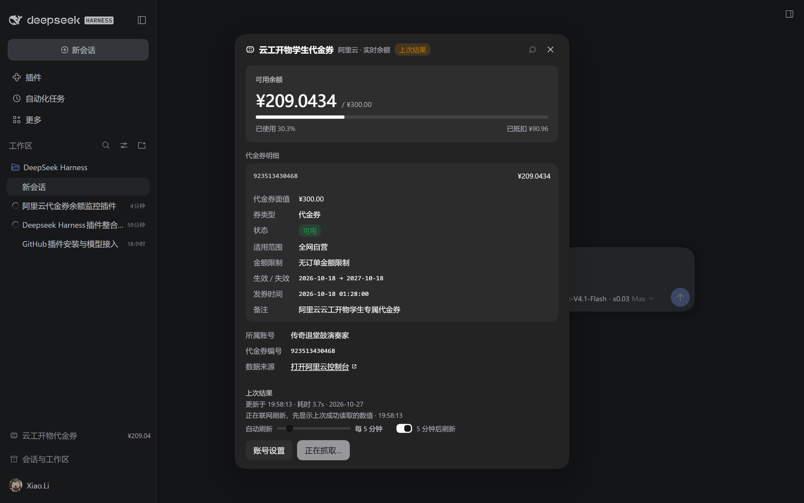
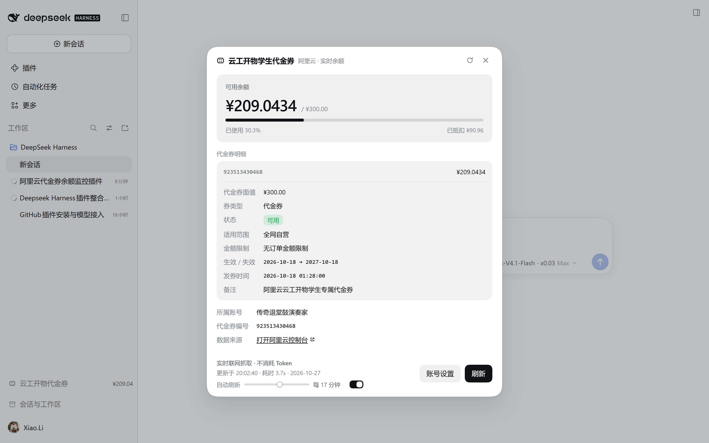

# dsh-aliyun-coupon

阿里云「云工开物」学生专属代金券余额查看器，作为 **DeepSeek Harness 插件**运行。

- **零 Token**：余额由本机 Host 半边的无头浏览器直接抓取阿里云费用与成本控制台，不经过任何大模型，不消耗 Token。
- **实时**：每次点开面板或点「刷新」都重新联网读取。界面会先把上一次的读数显示出来（标注「上次结果」），联网结果返回后立刻替换；抓取失败时保留旧值并明确标注「缓存值」与失败原因。
- **自动刷新**：只要 DSH 开着就按设定间隔自己重读，默认 **每 5 分钟**。面板底部是一条 1–30 分钟的滑块（每格 1 分钟，拖动时右侧数字实时跟随），旁边的开关可以临时关掉自动刷新——关闭后滑块变灰但记住位置，重新打开会回到之前选的分钟数。侧边栏的数字因此不打开面板也会保持最新。省流量靠三件事：间隔档位、浏览器热启动（空闲关闭时间保持在间隔之上，重复抓取复用已启动的浏览器与它的 HTTP 缓存）、以及宿主侧 30 秒最短抓取间隔。
- **原生观感**：侧边栏入口 + 居中对话框，完全复用 DSH 的主题变量（`--dsw-alias-*`）、圆角、字号与间距，与内置界面无差异，自动跟随浅色 / 深色主题。
- **跨版本**：插槽、React API、样式注入、宿主服务都做了多路兜底，不绑定某一个 DSH 版本的内部名字。详见下面的「跨版本兼容」。

> **English** — A DeepSeek Harness plugin that shows your Aliyun 「云工开物」 student coupon (¥300) balance live in the sidebar.
> **Zero tokens**: the number is scraped from the Aliyun billing console by a headless Chromium running on your own machine — no LLM involved, ever.
> **Real-time**: every open / refresh hits the network; auto-refresh is a 1–30 min slider (default 5 min).
> **Native look**: every color, radius and font size comes from DSH's own `--dsw-alias-*` theme tokens, so light/dark both feel built-in.
> **Cross-version**: slot names, React APIs, style injection and host services all have fallback chains — a DSH rename won't make the panel silently disappear.
> Windows / macOS / Linux, zero runtime dependencies. See [UPLOAD-GUIDE.md](UPLOAD-GUIDE.md) for publishing notes.


深色主题（颜色全部来自 DSH 的 `--dsw-alias-*`，跟着系统主题自动切换）：



自动刷新滑块：



## 自动刷新的流量开销

实测一次定时抓取（Windows + Edge，浏览器热启动、登录态与前端资源都已在本地缓存里）约 **93 KiB**，其中真正属于余额数据本身的只有约 8 KiB（`data/v2/multiApi.json` + `data/api.json`），其余主要是控制台页面自己的心跳与统计 beacon。脚本、样式、字体基本全部命中浏览器缓存，不计流量。

| 间隔 | 每天约 |
|---|---|
| 1 分钟 | 131 MiB |
| 5 分钟（默认） | 26 MiB |
| 15 分钟 | 8.7 MiB |
| 30 分钟 | 4.4 MiB |

第一次抓取（冷启动）明显更重，因为它要下载控制台的前端资源；之后的重复抓取基本只付上面这个数。宿主侧另有 30 秒最短抓取间隔兜底，手动刷新与定时刷新撞在一起时不会连续启动无头浏览器。

## 跨版本兼容

DSH 的插槽名、客户端内置服务、宿主服务名都属于**组合层契约**，不是永久不变的公开 API。插件因此不写死任何单一名字，而是「先试今天这个名字，不行就顺延」：

| 环节 | 策略 |
| --- | --- |
| 侧边栏入口 | 依次尝试 `sidebar.footer.action` → `sidebar.footer` → `sidebar.actions` → `sidebar.bottom`，第一个真实存在的声明拿到座位 |
| 面板挂载 | 依次尝试 `shell.overlay` → `shell.overlays` → `root.overlay` |
| 全都改名了 | 2.5 秒后仍没有任何 overlay 声明，就把同一套组件挂进 `document.body` 里的自有容器，保证面板不会「静默消失」 |
| React API | `useSyncExternalStore` 缺失时退回 `useState` + `useEffect` 订阅垫片 |
| 样式注入 | 有宿主 `styles` 内置就用它，没有就插入 `<style>` 标签（随插件卸载移除） |
| 宿主 HTTP 服务 | 依次尝试 `webServer` → `web-server` → `httpServer` → `server`；`ctx.inject` 不生效时还有 2 秒轮询兜底 |
| 宿主可选服务 | `credentials` / `connection` / `locale` 全部存在性守卫，缺哪个降级哪个，绝不让 DSH 起不来 |

自检入口：在 DSH 页面的控制台里执行 `window.__dshAliyunCouponCompat`，会返回本次实际落座的插槽名、React 版本、是否用到了 `styles` 内置。宿主侧另有 `GET /api/dsh-aliyun-coupon/diag`，其中的 `capabilities` 会告诉你本次用的是哪个 HTTP 服务名、路由有没有真的绑上、以及 `credentials` / `connection` / `locale` / `browser` 各自是否存在。给 issue 报障时把这两段一起贴上即可。

### 实测环境（1.3.1）

| 项 | 值 |
| --- | --- |
| DeepSeek Harness | `0.2.1-rc.3`（桌面版 Web UI） |
| 落座插槽 | `sidebar.footer.action` + `shell.overlay`（候选链第一项即命中） |
| React | 18.3.1（宿主提供，未打包） |
| `styles` 内置 | 不存在 → 自动降级为 `<style>` 标签 |
| 浏览器 | Microsoft Edge（`C:\Program Files (x86)\Microsoft\Edge\Application\msedge.exe`，自动探测命中） |
| 系统 | Windows 10/11 x64 |
| 结果 | 面板正常渲染、余额实时读取、深浅色跟随、滑块可用、无脱离式兜底触发（`detachedHosts: 0`） |

## 安装

**方式一：tarball（推荐分发给别人）**

从 [Releases](https://github.com/KERBALMans/dsh-aliyun-coupon/releases) 下载 `dsh-aliyun-coupon-1.3.1.tgz`，在 DSH 里执行「安装 bundle」，target 填它的绝对路径：

```
C:\Users\<you>\Downloads\dsh-aliyun-coupon-1.3.1.tgz
```

自己从源码打包也只要一条命令（在仓库目录里）：

```bash
npm pack
```

**方式二：源码目录（自己开发时用）**

```bash
git clone https://github.com/KERBALMans/dsh-aliyun-coupon.git
```

安装时 target 填克隆下来的**目录**绝对路径，profile 里会生成一个指向源码的 Junction，改代码即改安装物。

安装后侧边栏底部会出现「云工开物代金券」入口，点开按提示填写一次阿里云账号密码即可。

> Host 半边的改动不会热更新：改完 `index.js` 需要在插件管理里把插件关掉再打开一次。Client 半边（`client.js`）会随页面刷新生效。

## 第一次使用

1. 点侧边栏底部「云工开物代金券」。
2. 首次会弹出「连接你的阿里云账号」表单，填写账号（手机号 / 邮箱 / 会员名）和登录密码。
3. 点「保存并读取」，插件启动无头浏览器登录并读取代金券余额，首次约 15–25 秒。
4. 之后每次点开都是实时读取，约 5–10 秒。

账号密码保存在本机 DSH 凭据库（`credentials` 服务，refs：`ALIYUN_CONSOLE_ACCOUNT` / `ALIYUN_CONSOLE_PASSWORD`），不会上传到任何服务器，也不会写进本仓库。面板底部「账号设置」可随时更换或清除。

## 环境要求

| 项 | 要求 |
| --- | --- |
| DeepSeek Harness | 桌面版 / Web 版均可（Host 侧需提供 `webServer` 服务；缺失时插件静默不注册路由，不会让 DSH 起不来） |
| Node.js | ≥ 20（`fetch`、`AbortSignal.timeout`） |
| 浏览器 | 任意 Chromium 内核：Chrome / Edge / Chromium / Brave / Vivaldi |
| 系统 | Windows / macOS / Linux |

浏览器是**自动探测**的：Windows 找注册常见安装路径（Program Files、LocalAppData），macOS 找 `/Applications` 下的 .app，Linux 走 `PATH` 与 flatpak/snap 常见路径。探测不到时面板会给出明确提示。

## 配置（可选）

全部通过环境变量，均有合理默认值：

| 变量 | 默认 | 说明 |
| --- | --- | --- |
| `DSH_ALIYUN_BROWSER` | 自动探测 | 指定浏览器可执行文件绝对路径 |
| `DSH_ALIYUN_PROXY` | 无 | 强制使用代理，如 `http://127.0.0.1:7890` |
| `HTTPS_PROXY` / `HTTP_PROXY` | 无 | 系统代理；**只有该代理端口当前可连通时才会使用**，否则直连（避免残留代理导致 `ERR_PROXY_CONNECTION_FAILED`） |
| `DSH_HOME` | `~/.dsh` | DSH 数据目录；浏览器配置与缓存写在其下的 `storages/aliyun-coupon/` |
| `DSH_ALIYUN_IDLE_MS` | `720000` | 无头浏览器空闲多久后关闭（毫秒），保持热启动省流量 |
| `ALIYUN_CONSOLE_ACCOUNT` / `ALIYUN_CONSOLE_PASSWORD` | 无 | 无 GUI 场景（如 CI）可直接用环境变量提供凭据，跳过表单 |
| `DSH_ALIYUN_COUPON_REQUIRE_AUTH` | 未设置 | 设为 `0` 可关闭 DSH 连接鉴权（仅调试用） |

## 工作原理

```
┌─────────────────────── DSH Web UI (Client) ───────────────────────┐
│ sidebar.footer.action  ──点击──▶  shell.overlay 对话框             │
│        │                              │                            │
│        └──────── fetch /api/dsh-aliyun-coupon/balance ────────────┐│
└───────────────────────────────────────────────────────────────────┘│
                                                                     ▼
┌────────────────────── DSH Host（插件 Host 半边）────────────────────┐
│ webServer.register(prefix) ─▶ 启动/复用无头 Chromium                │
│   ├─ CDP over WebSocket（内置最小 RFC6455 实现，零依赖）            │
│   ├─ 打开 billing-cost.console.aliyun.com/coupons/coupon            │
│   ├─ 登录态失效时自动走 passport 登录表单                           │
│   ├─ 读取 <table> 表头 + 行，按列名映射为结构化 JSON                │
│   └─ 12 分钟无访问自动关闭浏览器（配置目录保留登录态）              │
└─────────────────────────────────────────────────────────────────────┘
```

- 不依赖 `ws` / `puppeteer` / `playwright`：WebSocket 与 CDP 都是内置实现，安装体积为 0 依赖。
- 路由前缀 `/api/dsh-aliyun-coupon`，支持 `GET /balance`、`GET|POST|DELETE /setup`、`GET /diag`。
- 鉴权复用 DSH 的 `connection.admit`（校验签名 cookie + 活跃 Peer）；老版本没有该服务时自动降级放行，保证跨版本可用。
- 登录表单在 `passport.aliyun.com` 的**跨域 iframe** 里，所以 CDP 侧按 `Runtime.executionContextCreated` 跟踪所有执行上下文，在任意上下文里找 `#fm-login-id` / `#fm-login-password` 并填入。

## 目录结构

```
dsh-aliyun-coupon/
├── index.js            # Host 半边：路由 + 无头浏览器抓取
├── client.js           # Client 半边：侧边栏入口 + 对话框
├── cordis.patch.yml    # bundle 插入声明
├── locale/{zh,en}.json # 插件元信息
├── icon.svg            # 插件图标
├── docs/               # 截图
└── package.json
```

## 常见问题

**Q：提示「未检测到 Chrome / Edge / Chromium」？**
安装任意 Chromium 内核浏览器，或设置 `DSH_ALIYUN_BROWSER` 指向可执行文件后重启 DSH。

**Q：提示登录失败？**
账号开启了二次验证（短信 / 扫码）时无法纯脚本登录。先用普通 Chrome 打开一次阿里云登录并完成验证；插件复用同一份浏览器配置目录，之后即可自动读取。或在面板里点「账号设置」重新填写。

**Q：数据不对 / 想自己核对？**
面板底部有「打开阿里云控制台」直链，可跳转到同一页面人工核对。

**Q：会不会偷偷上传我的密码？**
不会。密码只写入本机 DSH 凭据库，仅用于填入 `passport.aliyun.com` 的登录表单。插件没有任何外部上报端点，源码可完整审计。

**Q：升级 DSH 之后插件不见了？**
先看控制台里 `window.__dshAliyunCouponCompat` 的输出。如果 `footerSlot` 是 `null` 且 `overlaySlot` 显示 `detached`，说明新版本把所有已知插槽名都改了——带着这段输出提 issue，通常只需要在 `client.js` 顶部的 `FOOTER_SLOTS` / `OVERLAY_SLOTS` 里加一个新名字。

## 开发

```bash
# 语法检查
node --check index.js && node --check client.js

# 本机调试：查看路由状态
curl http://127.0.0.1:<gui-port>/api/dsh-aliyun-coupon/diag
```

## 发布到 GitHub

见 [UPLOAD-GUIDE.md](UPLOAD-GUIDE.md)（手把手、纯网页操作）与 [REPO-COPY.md](REPO-COPY.md)（仓库简介、About、Release 说明等可直接复制的文案）。

## License

MIT
